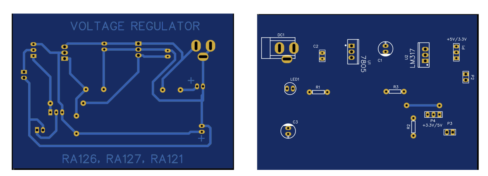
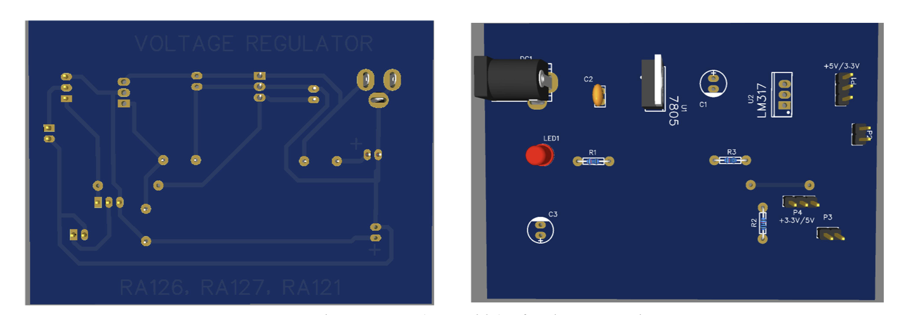

# Dual-Output Regulated Power Supply

A compact dual-output DC power supply designed using **LM7805** and **LM317** linear voltage regulators. The circuit accepts a **9 V DC input** and provides regulated **5 V** and **3.3 V** outputs.

The complete circuit schematic and PCB were designed in **EasyEDA**, followed by PCB fabrication, component assembly, and hardware testing.

---

## Features

- 9 V DC input
- Fixed 5 V regulated output using LM7805
- 3.3 V regulated output using LM317
- Dual regulated output rails
- LED power indicator
- Input and output stabilization capacitors
- Compact PCB implementation
- Output headers for convenient circuit interfacing
- Fabricated and hardware tested

---

## System Overview

The 9 V DC input is supplied to two separate voltage regulation sections.

```text
                        9 V DC Input
                             |
                 +-----------+-----------+
                 |                       |
                 v                       v
              LM7805                  LM317
                 |                       |
                 v                       v
          5 V Regulated           3.3 V Regulated
              Output                  Output
```

The **LM7805** provides the fixed 5 V rail, while the **LM317** is configured using external resistors to generate the 3.3 V rail.

---

## Circuit Design

### LM7805 — 5 V Regulator

The LM7805 is used to generate a fixed regulated **5 V output** from the 9 V input.

The section includes:

- LM7805 voltage regulator
- 1 µF input capacitor
- 0.1 µF output capacitor
- 5 V output connection

The capacitors are included to improve regulator stability.

### LM317 — 3.3 V Regulator

The LM317 adjustable voltage regulator is configured to generate approximately **3.3 V**.

The voltage-setting resistors used are:

- R1 = 330 Ω
- R2 = 560 Ω

The LM317 output voltage is approximately determined by:

```text
Vout = 1.25 × (1 + R2/R1)
```

An LED with a current-limiting resistor is also included as a power indicator.

---

## Circuit Schematic

The complete circuit schematic was created using **EasyEDA**.


Individual sections of the circuit are also available in the [`schematic/`](schematic/) directory.

---

## PCB Design

The PCB was designed in **EasyEDA** after completing the circuit schematic.

The PCB design process included:

- Schematic capture
- Component footprint selection
- Component placement
- PCB routing
- Design Rule Checking (DRC)
- 2D PCB verification
- 3D PCB visualization
- Gerber file generation

### 2D PCB Layout



### 3D PCB View



The Gerber and manufacturing files are available in:

```text
pcb/gerber/
```

---

## Hardware Implementation

The designed PCB was fabricated and assembled with the required components.


The completed board was tested using a digital multimeter to verify both regulated output rails.

---

## Components Used

| Component | Quantity | Function |
|---|---:|---|
| LM7805 Voltage Regulator | 1 | Provides fixed 5 V output |
| LM317 Voltage Regulator | 1 | Provides adjustable 3.3 V output |
| 330 Ω Resistor | 1 | LM317 voltage-setting network |
| 560 Ω Resistor | 2 | LM317 network and LED current limiting |
| 0.1 µF Ceramic Capacitor | 1 | Regulator stabilization |
| 1 µF Electrolytic Capacitor | 2 | Filtering and stabilization |
| LED | 1 | Power indication |
| DC Barrel Jack | 1 | DC input connection |
| Male Header Pins | 2 | Output connections |
| PCB | 1 | Circuit implementation |

---

## Testing and Results

The fabricated circuit was tested using a **9 V DC input** and the output voltages were measured using a digital multimeter.

| Parameter | Expected | Measured |
|---|---:|---:|
| Input Voltage | 9 V DC | 9 V DC |
| LM7805 Output | 5 V | **5.01 V** |
| LM317 Output | 3.3 V | **3.29 V** |
| Power Indicator | ON | ON |

The measured output voltages were close to their designed values, confirming proper operation of both voltage regulation sections.

---

## Repository Structure

```text
LM7805-LM317-Power-Supply/
│
├── README.md
│
├── Schematic/
│   ├── complete_schematic.png
│   ├── lm7805_5v_section.png
│   ├── lm317_3v3_section.png
|   ├── Input_distribution.png
│   └── output_distribution.png
│
├── pcb/
│   ├── pcb_2d_layout.png
│   ├── pcb_3d_view.png
│   └── gerber/
│       └── [Gerber and drill files]
│
├── source/
│   └── easyeda/
│       └── [EasyEDA source files]
│
└── hardware/
    ├── assembled_pcb.jpg
    └── output_measurement.jpg
```

---

## Tools Used

### EasyEDA

Used for:

- Circuit schematic design
- PCB layout design
- Component footprint selection
- Design Rule Checking
- PCB visualization
- Gerber file generation

### Digital Multimeter

Used to measure and verify the regulated output voltages after PCB assembly.

---

## Results

The completed circuit successfully produced two regulated voltage outputs from a 9 V DC input:

- **5.01 V** from the LM7805 section
- **3.29 V** from the LM317 section

The project demonstrates the complete hardware development process from **circuit design and PCB layout to fabrication, assembly, and hardware testing**.

---

## Applications

The regulated outputs can be used to power low-voltage electronic circuits such as:

- Digital logic circuits
- Microcontrollers
- Sensor circuits
- Prototype electronic circuits
- Laboratory experiments

---

## Project Files

- [`schematic/`](schematic/) — Circuit schematic and individual regulator sections
- [`pcb/`](pcb/) — PCB layout, 3D view, and manufacturing files
- [`source/easyeda/`](source/easyeda/) — Editable EasyEDA project files
- [`hardware/`](hardware/) — Fabricated PCB and testing images
